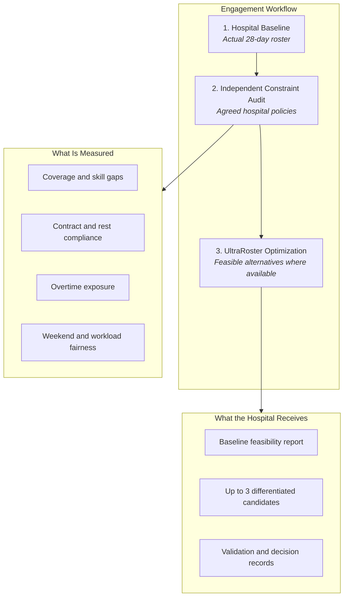

# UltraRoster Independent Optimization Assessment Protocol v1.0
**Framework for Retrospective Hospital Workforce Optimization Audits**  
**Classification:** Commercial & Operational Methodology  
**Target Engagement:** Paid Retrospective Diagnostic (Single Department, 30–80 Beds, 40–80 Nurses, 28 Days)  
**Document Status:** Publication-Grade Project Baseline

---

## 1. Executive Summary & Presentation Architecture

### 1.1 Objective
The UltraRoster Independent Optimization Assessment is a diagnostic commercial engagement designed to evaluate whether mathematical combinatorial optimization can produce superior, lower-cost, and more equitable workforce allocations compared to a hospital's incumbent scheduling method.

The assessment is conducted **retrospectively on anonymized historical workforce data**. It requires **no live hospital information system (HIS) integration, no HRIS replacement, and zero operational disruption** to clinical operations.

### 1.2 Revised 60-Second Executive Opening
> *"We are not asking you to replace your hospital information system or change how your nursing supervisors manage daily rosters.*
> 
> *UltraRoster takes your existing workforce requirements and evaluates the complete 28-day planning horizon together. It checks the schedule against your approved contractual and operational constraints, and explores alternative schedules across competing objectives such as workload balance, preferences, and weekend fairness.*
> 
> *We propose starting with one ward and an anonymized historical roster. You receive an independent feasibility assessment, a comparison with your existing roster, and alternative schedules where feasible.*
> 
> *There is no requirement to integrate with your existing systems or change live hospital operations for this assessment.*
> 
> *The objective is straightforward: establish, using your own workforce data and approved policies, whether mathematical optimization can produce better scheduling choices and measurable operational value."*

### 1.3 Executive Assessment Flow



### 1.4 Frozen Commercial Scope

| Scope Dimension | Specification |
| :--- | :--- |
| **Recommended Entry** | Option C: Retrospective Optimization Diagnostic |
| **Assessment Horizon** | 28 days (4 consecutive contractual weeks) |
| **Initial Unit Scope** | One ward / clinical department (e.g., ICU, Oncology, or Step-Down) |
| **Workforce Target** | 40–80 nursing personnel |
| **Data Exchange Format** | Anonymized structured CSV |
| **Assessment Inputs** | Existing historical roster, worker skills/certifications, contract policies, shift requirements, historical boundary assignments, and hospital-approved staffing rules. |
| **Assessment Outputs** | Independent constraint audit, coverage and skill-gap analysis, workload and weekend fairness measures, optimization alternatives where available, and a documented comparison against the existing roster. |
| **Excluded from Initial Scope** | Direct HIS/HRIS integration, live rostering, real-time dispatch, leave management workflows, payroll automation, biometric punch integration, clinical patient-acuity modeling, and enterprise multi-tenancy. |
| **Data Governance & Privacy** | Controlled handling under NDA or suitable Data Processing Agreement (DPA). Minimum necessary fields, isolated single-tenant workspace, 30-day retention with documented deletion. Zero patient-identifiable data required or accepted. |

---

## 2. Evidence Controls & Wording Standards

To protect the commercial engagement and technical architecture from technical and commercial overclaiming, all client communications, marketing materials, and assessment deliverables must strictly follow the required wording controls below.

### 2.1 Wording Control Standard

| Current Statement / Marketing Shorthand | Publication-Grade Recommended Formulation |
| :--- | :--- |
| *Guarantee zero regulatory violations* | **Zero violations across the hospital-approved hard constraints encoded in the assessment, independently rechecked by the validator.** |
| *Eliminate unneeded overtime* | **Identify opportunities to reduce scheduled excess hours; verify actual overtime reduction using payroll or timekeeping data.** |
| *Return 2–3 feasible candidates* | **Return up to three materially different feasible candidates, where the optimization produces them.** |
| *Zero operational risk* | **Retrospective, low-disruption assessment without changes to live hospital operations.** |
| *Traditional tools schedule sequentially* | **Compare the current roster and its documented workflow against jointly optimized alternatives.** |
| *Full audit provenance* | **Provide the available input, constraint, candidate, validation and human-decision records.** |

### 2.2 Three Critical Technical & Commercial Qualifications

1. **Independent Verification Standard:**  
   A truthful boolean flag (`is_valid`) in an API response is necessary, but does not by itself establish independent verification. True verification requires the validator to **recompute all hard constraints directly from the raw assignment matrix (`HashMap<shift_id, worker_id>`) using the hospital-approved planning request**, rather than trusting internal optimizer penalty scores or cached evaluations.
2. **Contractual Weekly Bucket Semantics:**  
   The optimization engine evaluates multi-week contracts in 168-hour weekly intervals. These bucket boundaries must correspond to each hospital's **actual contractual or payroll week calendar anchor** (e.g., Monday 00:00 to Sunday 23:59 vs. Sunday 00:00 to Saturday 23:59). An arbitrary 168-hour interval starting on the planning horizon's first day cannot be assumed to match the hospital's contractual week without explicit calendar synchronization.
3. **Overtime Evidence Standard (CFO Distinction):**  
   A historical roster alone identifies **scheduled overtime exposure** (hours scheduled above contract caps), but cannot establish **actual paid overtime expenditure**. Validating realized financial savings requires reconciliation against actual payroll, punch-clock, or timekeeping disbursements.
4. **Sprint v2 Release Evidence Standard:**  
   Technical audit references, engine test results (106 unit tests), and frontend test suites (50 Vitest tests) represent reported engineering baseline evidence (Commit `067702da1` and subsequent sprint commits), rather than an independent third-party audit.

---

## 3. Standard Input Data Contract (CSV Specifications)

Data is ingested using four normalized CSV files. All personal identifiable information (PII) must be stripped prior to transfer.

### 3.1 File 1: `staff.csv`
Defines the workforce pool, certified competencies, and contractual parameters.

| Column Name | Data Type | Requirement | Description / Permitted Values |
| :--- | :--- | :--- | :--- |
| `worker_id` | String | Mandatory | Anonymized identifier (e.g., `N_01`, `RN_104`). |
| `contract_type` | String | Mandatory | `FullTime`, `PartTime`, or `NightDedicated`. |
| `skills` | String | Mandatory | Semicolon-delimited skills (e.g., `HeadNurse;Nurse`, `ICU;Ventilator`). |
| `weekly_max_hours` | Decimal | Mandatory | Contractual maximum hours per week (e.g., `40.0`, `48.0`, `32.0`). |
| `max_consecutive_days` | Integer | Mandatory | Maximum continuous working days before off (default: `5` or `6`). |
| `min_rest_hours` | Integer | Mandatory | Minimum mandatory rest gap between shifts (default: `10` or `12`). |
| `max_weekends_per_cycle` | Integer | Mandatory | Maximum number of working weekends allowed in the 28-day cycle. |

```csv
worker_id,contract_type,skills,weekly_max_hours,max_consecutive_days,min_rest_hours,max_weekends_per_cycle
N_01,FullTime,HeadNurse;Nurse,40.0,5,10,2
N_02,FullTime,Nurse,40.0,5,10,2
N_03,PartTime,Nurse,24.0,4,12,2
N_04,NightDedicated,Nurse;ICU,36.0,4,14,2
```

### 3.2 File 2: `shifts.csv` (Canonical Shift-Slot Demand)
Defines the discrete shift demand slots required across the 28-day horizon (672 hours). Per Control A, the canonical contract is frozen to pre-expanded shift slots with exactly one row per position required.

| Column Name | Data Type | Requirement | Description / Permitted Values |
| :--- | :--- | :--- | :--- |
| `id` (or `shift_id`) | Integer | Mandatory | Unique integer identifier across the entire planning horizon (e.g., `1` to `N`). |
| `start_hour` | Integer | Mandatory | Relative horizon start hour (`0` to `671`). |
| `duration_hours` | Integer | Mandatory | Duration of duty in hours (standard: `8`). |
| `required_skill` | String | Mandatory | Minimum certified skill required to staff the position (e.g., `HeadNurse`, `Nurse`). |
| `shift_type` | String | Optional | Descriptive shift label: `Early` (06:00–14:00), `Late` (14:00–22:00), `Night` (22:00–06:00). |
| `date` | Date | Optional | Calendar date (`YYYY-MM-DD`). |
| `ward` | String | Optional | Ward or unit code (e.g., `ICU_Ward_A`). |

```csv
id,start_hour,duration_hours,required_skill,shift_type
1,6,8,HeadNurse,Early
2,6,8,Nurse,Early
3,14,8,Nurse,Late
4,22,8,Nurse,Night
```

### 3.3 File 3: `history_boundary.csv`
Captures historical boundary conditions immediately preceding Day 0. Essential for multi-week continuity (prevents nurses from working excessive consecutive days across the cycle boundary).

| Column Name | Data Type | Requirement | Description |
| :--- | :--- | :--- | :--- |
| `worker_id` | String | Mandatory | Matches `staff.csv`. |
| `prior_shift_end_hour` | Integer | Mandatory | Relative hour when nurse completed their last shift prior to Day 0. |
| `consecutive_work_days_prior` | Integer | Mandatory | Continuous working streak ending on Day -1. |
| `consecutive_rest_days_prior` | Integer | Mandatory | Continuous rest streak ending on Day -1. |
| `working_weekends_month_to_date` | Integer | Mandatory | Count of weekends worked in the preceding 2 weeks. |

### 3.4 File 4: `unavailability.csv`
Pre-approved planned leave, medical absences, and mandatory training sessions.

| Column Name | Data Type | Requirement | Description |
| :--- | :--- | :--- | :--- |
| `worker_id` | String | Mandatory | Matches `staff.csv`. |
| `start_date` | Date | Mandatory | Start date (`YYYY-MM-DD`). |
| `end_date` | Date | Mandatory | End date (`YYYY-MM-DD`). |
| `reason` | String | Mandatory | `AnnualLeave`, `MedicalLeave`, `Training`, or `ApprovedOff`. |

### 3.5 File 5: `hospital_baseline.csv` (Historical Roster Ingestion)
The historical roster for retrospective audit against ratified hospital policy and constraints.

| Column Name | Data Type | Requirement | Description / Permitted Values |
| :--- | :--- | :--- | :--- |
| `worker_id` | String | Mandatory | Identifies the assigned staff member (must match `staff.csv`). |
| `shift_id` | Integer | Mandatory | Identifies the shift demand position assigned (must match `shifts.csv`). |

```csv
worker_id,shift_id
Sarah_Chen,1
Marcus_Webb,2
Priya_Nair,3
```

**Baseline Retention Invariant:** Excess, duplicate, or unmatched baseline assignments must never silently disappear from the audit. All rows are retained, and anomalies (such as duplicate entries or assignments to unknown shift IDs) are surfaced explicitly in the Assignment Integrity Report.

---

## 4. Hospital Policy & Constraint Questionnaire

Before optimization, the Chief Nursing Officer (CNO) and Nursing Administration ratify this policy questionnaire. These answers establish the objective criteria for both the baseline audit and candidate optimization.

```markdown
### SECTION A: CALENDAR & CONTRACTUAL RULES
1. Weekly Boundary Definition:
   [ ] Monday 00:00 to Sunday 23:59
   [ ] Sunday 00:00 to Saturday 23:59
   [ ] Other (specify): _____________________

2. Contractual Working Hours:
   Full-Time Standard: ____ hours/week | Maximum Allowed Before Overtime: ____ hours/week
   Part-Time Standard: ____ hours/week | Maximum Allowed Before Overtime: ____ hours/week

3. Overtime Classification:
   Is overtime permissible as an operational fallback?
   [ ] Strictly prohibited (Hard Constraint)
   [ ] Permissible with penalty (Soft Objective)

### SECTION B: REST & ERGONOMIC CONSTRAINTS
4. Inter-Shift Rest Period:
   Minimum hours between shifts: [ ] 10 hours  [ ] 11 hours  [ ] 12 hours  [ ] 14 hours

5. Working Streaks:
   Maximum consecutive working days: [ ] 5 days  [ ] 6 days  [ ] 7 days
   Minimum consecutive rest days following a work streak: [ ] 1 day  [ ] 2 days

6. Night Duty Policies:
   Maximum consecutive night duties allowed: [ ] 2  [ ] 3  [ ] 4
   Minimum rest hours required following a night duty cycle: [ ] 24 hours  [ ] 48 hours
   Is a Night → Early quick return strictly forbidden? [ ] Yes (Hard)  [ ] No

### SECTION C: SKILL MIX & WEEKEND DISTRIBUTION
7. Leadership Coverage:
   Is at least one Senior Nurse / Head Nurse mandatory on EVERY shift?
   [ ] Yes, mandatory on all shifts (Hard Constraint)
   [ ] Yes, but night shifts exempt if experienced nurse present
   [ ] Desirable, not mandatory (Soft Objective)

8. Weekend Equity:
   Maximum working weekends per 28-day cycle: [ ] 2 weekends  [ ] 3 weekends
   Complete weekend rule: Must both Saturday & Sunday be assigned together?
   [ ] Yes (Complete weekends)  [ ] No (Individual days acceptable)
```

---

## 5. Baseline Roster Scoring & Optimization Methodology

The hospital's actual 28-day historical schedule is ingested as `hospital_baseline.csv` (`worker_id`, `shift_id`).

### 5.1 The Equivalence Standard
**The existing roster and the UltraRoster alternatives must be assessed against the exact same policy version.**  
If the baseline were evaluated under one set of assumptions while the alternatives were evaluated under another, the comparison would lack scientific and commercial validity.

### 5.2 Evaluation Dimensions
1. **Mandatory Hard Constraint Violations:**
   * **HC1 (Skill / Coverage Deficit):** Shift slots staffed by personnel lacking certified competencies, or senior coverage deficits.
   * **HC2 (Double Booking & Overlap):** A worker assigned to overlapping shifts or shifts separated by $< 0$ hours.
   * **HC3 (Weekly Contract Cap Breaches):** Total assigned hours within any 168-hour contractual week exceeding the worker's contract cap (`weekly_max_hours`).
   * **HC4 (Approved Leave Incursions):** Assignments falling within approved leave windows.
   * **Rest (Inter-Shift Deficit):** Assignments with rest gaps less than the hospital-approved minimum (e.g., $< 10$ hours).
2. **Soft Operational Trade-Offs:**
   * **Fairness Variance ($\sigma^2$):** Workload variance across full-time nursing cohorts.
   * **Night Duty Skew:** Variance in night shift burden across peer nurses.
   * **Weekend Distribution:** Number of nurses exceeding contractual weekend caps.
3. **Scheduled Overtime Exposure:**
   Sum of all scheduled hours allocated above weekly contractual caps:
   $$\text{Scheduled Overtime Hours} = \sum_{w \in \text{workers}} \sum_{k=1}^{4} \max\left(0, \text{Hours}_{w,k} - \text{ContractCap}_w\right)$$

### 5.3 Optimization & Candidate Extraction
Using the ratified planning contract, UltraRoster executes the Coralys Multi-Objective Genetic Algorithm (MOGA) over the full 28-day horizon (672 hours).

The optimizer returns **up to three materially different feasible candidates, where the optimization produces them**:
* **Candidate A (Scheduled Overtime & Cost Minimized):** Balances assignments to contract thresholds, reducing scheduled excess hours while meeting 100% of required shift demand.
* **Candidate B (Workforce Equity & Preferences):** Minimizes workload variance ($\sigma^2$); strictly equalizes weekend and night duties across peer cohorts.
* **Candidate C (Ergonomic & Shift Continuity):** Minimizes shift rotation turbulence; maximizes consecutive days off following night duty blocks.

---

## 6. Independent Feasibility & Audit Verification Procedure

The candidate schedules returned by the optimizer must pass an independent verification gate before presentation.

### 6.1 The Re-Computation Standard
* **Decoupled Verification:** The verification tool must **never read cached optimizer scores or penalty weights**.
* It takes only two artifacts:
  1. The raw assignment matrix: `HashMap<shift_id, worker_id>`
  2. The approved planning contract (`staff.csv`, `shifts.csv`, `unavailability.csv`, ratified policies).
* It reconstructs the entire timeline from raw assignments and re-computes every rule.

### 6.2 Acceptance Gate
A candidate schedule is approved for customer presentation **if and only if**:
$$\text{Hard Violations} = 0 \quad (\text{HC1} = 0, \, \text{HC2} = 0, \, \text{HC3} = 0, \, \text{HC4} = 0, \, \text{Rest Violations} = 0)$$

Any candidate containing even one mandatory violation is automatically classified as an Exception and disqualified from recommendation.

---

## 7. Financial & Operational Measurement Rules

To maintain CFO-ready credibility, UltraRoster enforces strict accounting boundaries between paper capacity and cash expenditure.

```
┌────────────────────────────────────────────────────────────────────────┐
│                        FINANCIAL IMPACT TAXONOMY                       │
│                                                                        │
│   CATEGORY 1: VERIFIED CASH BENEFIT (CFO Metrics)                      │
│   • Avoided Overtime: Direct reduction in payroll overtime payouts.    │
│   • Avoided Locum/Agency: Elimination of external nursing invoices.     │
│   • Formula:                                                           │
│     Cash Savings = Δ Overtime Paid + Δ Agency Billed - Software Cost   │
│                                                                        │
│   CATEGORY 2: OPERATIONAL CAPACITY REINVESTMENT (CNO Metrics)          │
│   • Supervisor Time Released: ~30-40 hours/month freed from scheduling. │
│   • Classification: Clinical care reinvestment / supervision hours.    │
│   • Rule: NEVER multiply supervisor hours by nurse wages and report as │
│           "cash-out-the-door savings" unless headcount is eliminated.  │
│                                                                        │
│   CATEGORY 3: RETENTION & RISK MITIGATION (COO Metrics)                │
│   • Regulatory Legal Compliance: Zero statutory rest breaches.         │
│   • Reduced Attrition Exposure: Equitable night and weekend balance.   │
└────────────────────────────────────────────────────────────────────────┘
```

### 7.1 Financial Attribution Protocol
1. **Historical Assessment Phase:**
   Calculate **Scheduled Overtime Exposure** (hours above contract cap in the roster). Do not claim historical exposure is realized cash savings until correlated with payroll logs.
2. **Controlled Shadow / Live Pilot Phase:**
   Compare the optimized period against an equivalent historical baseline (matching bed occupancy, patient acuity, and nursing headcount). Calculate actual payroll variance:
   $$\Delta \text{Overtime Cost} = \text{Baseline Paid Overtime} - \text{Pilot Paid Overtime}$$

---

## 8. Commercial Readiness Checklist (The Five Remaining Gates)

The commercial diagnostic engagement is released to a hospital prospect only upon satisfying all five gates:

| Gate | Required Evidence | Verification Standard |
| :--- | :--- | :--- |
| **1. Technical Gate** | End-to-end run from CSV intake through MOGA optimization, independent re-computation verification, and export. | Clean automated pipeline run; zero unhandled panics; independent validator certifies `hard_violations == 0`. |
| **2. Policy Gate** | Hospital-approved contract, rest, skill, and coverage rules ratified in writing. | CNO / Nursing Superintendent signed questionnaire establishing the objective criteria. |
| **3. Baseline Gate** | Existing historical roster evaluated under *exactly the same agreed rules* as the alternatives. | Side-by-side audit run with identical constraint engine version and calendar weekly bucket anchors. |
| **4. Financial Gate** | Planned overtime separated from actual paid overtime; released supervisor time classified as capacity reinvestment. | CFO-compliant metric separation; zero paper wage multipliers reported as bank cash savings. |
| **5. Governance Gate** | Data processing agreement (DPA) / NDA executed; access control, retention, and deletion protocols established. | Single-tenant isolation confirmed; data minimization audit passed; 30-day deletion schedule confirmed. |

---

## 9. Final Strategic Positions & Governance Anchors

The following strategic decisions are frozen for UltraRoster:

1. **Independent Product Boundary:** UltraRoster is an independent hospital workforce optimization product, not an extension or feature flag of UltraCrew.
2. **Core Technical Differentiator:** Joint 28-day combinatorial optimization, approved constraint modeling, independently checked feasibility, and transparent decision provenance.
3. **Clinical Boundary:** Clinical acuity, nurse-to-patient ratios, and bed-demand forecasting remain external to the combinatorial solver. UltraRoster consumes approved demand as an authoritative input.
4. **Commercial Entry:** Retrospective independent optimization assessment, single ward, 28 days, anonymized workforce data.
5. **Economic Proof:** Actual expenditure reductions claimed only when supported by payroll, invoice, or timekeeping disbursements.
6. **Commercial Expansion:** Live workflow adoption, HIS integration, and recurring subscription expansion occur only after the retrospective assessment establishes a convincing, verified business case.

---

## 10. Customer Assessment Deliverable Report (Template)

Upon completion of the audit, the hospital leadership receives the following executive presentation and technical appendix.

```markdown
# UltraRoster Optimization Audit Report
**Hospital:** [Anonymized Hospital Name] | **Department:** [ICU / Surgical Ward]  
**Dates Evaluated:** 28-Day Cycle ([Start Date] to [End Date])  
**Workforce Evaluated:** [N] Nurses | [M] Shifts Scheduled  

---

### Executive Scorecard: Baseline vs. Optimized Candidates

| Metric | Hospital Historical Baseline | Candidate A (Cost Minimized) | Candidate B (Equity Balanced) | Operational Significance |
| :--- | :---: | :---: | :---: | :--- |
| **Mandatory Hard Violations** | **14** | **0** | **0** | Zero violations across approved constraints |
| • Rest breaches (<10h gap) | 8 | 0 | 0 | Fatigue mitigation & quick return prevention |
| • Weekly hour cap breaches | 4 | 0 | 0 | Contract compliance across weekly buckets |
| • Uncovered senior nurse shifts | 2 | 0 | 0 | Clinical leadership coverage |
| • Leave clashes | 0 | 0 | 0 | Approved leave protection |
| **Scheduled Overtime Exposure** | **112 hours** | **0 hours** | **16 hours** | Identifies opportunities to reduce excess hours |
| **Workload Variance ($\sigma^2$)** | 18.4 | 4.2 | 1.8 | Cohort equity and burnout prevention |
| **Max Working Weekends** | 4 (3 nurses) | 2 (0 nurses) | 2 (0 nurses) | Weekend fairness across cohort |
| **Night Shift Load Variance** | ± 4 shifts | ± 1 shift | 0 shifts | Equal night duty burden |

---

### Key Operational Findings

1. **Rest Period Compliance:**
   The historical roster contained 8 instances where nurses had less than 10 hours between consecutive shifts (e.g., Late shift ending at 22:00 followed immediately by an Early shift at 06:00). UltraRoster's candidates eliminate 100% of these occurrences.

2. **Scheduled Overtime Exposure:**
   In the baseline schedule, 112 hours were scheduled beyond contractual 40h/week caps across 7 nurses, primarily due to localized coverage gaps. Candidate A meets 100% of shift requirements with zero scheduled overtime through optimized skill-matching.

3. **Weekend & Night Fairness:**
   In the historical schedule, 3 nurses were assigned to work all 4 weekends in the month, while others worked only 1. Candidate B caps weekend assignments at 2 per nurse across the entire team.

---

### Recommended Action Plan
1. Review candidate assignments with ward supervisors for clinical qualitative feedback.
2. Cross-reference the 112-hour scheduled overtime exposure against actual payroll payouts.
3. Conduct a 4-week prospective shadow observation to validate operational adoption.
```

---

## 11. Engagement Governance & Data Protection Agreement

1. **Data Minimization:** Only anonymized worker IDs, certification categories, and historical shift assignments are ingested. No patient information, employee names, national IDs, or home addresses are ever collected or accepted.
2. **Access Control:** Data is processed in an isolated single-tenant workspace. No customer data is shared or retained across client boundaries.
3. **Retention & Disposal:** All raw CSV files, intermediate genomes, and assessment databases are permanently sanitized and deleted within 30 days of deliverable delivery upon written request.
4. **Independent Intellectual Property:** The hospital retains complete ownership of its operational data and policies. Coralys retains all rights to its combinatorial solvers, MOGA algorithms, and optimization architectures.
