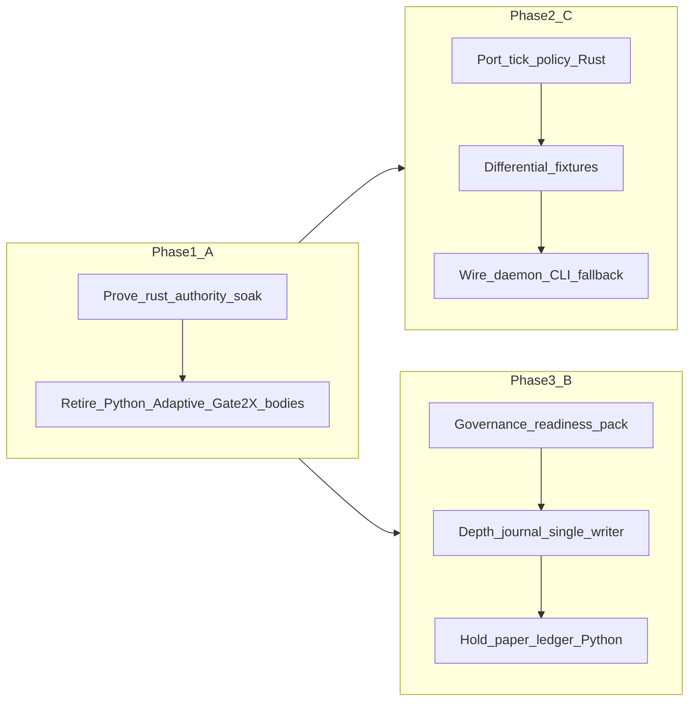

# RP-608 Rust Migration Plan — Tracks A / B / C

**Date:** 2026-11-22  
**Authority:** 0% · **Rules:** `.cursor/rules/chronosentiment-core.mdc`, `rp608-ofx.mdc`  
**Frozen:** OF ±0.30 L1 construct · Gate 5 for Estimand A / traj15 / stops / targets · books never pooled  
**Companions:**  
- [`rp608_rust_plan_lifecycle_cutover.md`](rp608_rust_plan_lifecycle_cutover.md)  
- [`RP608_NSE_PUSH_EVENT_RUST_ENGINE_v1.md`](../architecture/RP608_NSE_PUSH_EVENT_RUST_ENGINE_v1.md)  
- [`RP608_NSE_PYTHON_PRODUCTION_INVENTORY_v1.md`](../architecture/RP608_NSE_PYTHON_PRODUCTION_INVENTORY_v1.md)

---

## Goal

Replace Python **decision / event cores** with Rust while Python remains WS I/O, journals, and fail-closed fallback until each track clears soak + differential parity. Do **not** dual-write ledgers. Do **not** change trading rules under the guise of a port.

**Execution order:** A first (nearest done) → C and B readiness in parallel after A soak starts → B writer flip only after explicit governance sign-off.

---

## Track A — Finish plan-lifecycle cutover

### Live cutover snapshot (Pi · 2026-11-22 ~09:35 IST)

| Check | Result |
| --- | --- |
| `rp608_position_decide.aarch64-linux` | Present (~1.0 MiB); crypto + ETH units point `RP608_POSITION_DECIDE_BIN` / `RP608_GATE2X_MANAGE_BIN` at it |
| `RP608_PLAN_LIFECYCLE` in systemd | **Set `=1`** on crypto + ETH + NSE units |
| `RP608_PLAN_LIFECYCLE_REQUIRE_RUST` | **Set `=1`** on crypto + ETH + NSE units (hard fail-closed) |
| CRYPTO BASELINE today IST | **17/17** rust (8× SL, 9× `TRAILING_STOP_HIT`) — soak_ok |
| CRYPTO ETH today IST | **3/3** rust (`TRAILING_STOP_HIT`) — soak_ok |
| CRYPTO PRIMARY today IST | **0** closes (Gate 2E `allow_only` — not a lifecycle miss) |
| CRYPTO last 24h | PRIMARY 15 rust / 1 UNSET; BASELINE 41 rust / 1 UNSET (pre-require-rust residual) |
| NSE systemd PLAN_LIFECYCLE env | `PLAN_LIFECYCLE=1` + `REQUIRE_RUST=1` + decide bins; stamp audit next session |
| Audit script | `scripts/research/rp608_plan_lifecycle_authority_audit.py` (deployed on Pi) |

**A status:** Soft cutover green on BASELINE + ETH; **hard fail-closed (`REQUIRE_RUST`) enabled on Pi**. Soak not closed until multi-day PRIMARY/NSE evidence + Python manage bodies retired.

### Current state

| Layer | Owner today |
| --- | --- |
| Adaptive TP + hard SL/TP + Gate 2X Protect/Exit + trailing SL | Rust `PlanLifecycleManager` via `rp608_position_decide --plan-lifecycle-loop` |
| WS, entries, journals, OF paper, OFX | Python |
| Python Adaptive / Gate2X bodies | Still present as **fallback** when Rust missing / loop fails |

Key files:
- Rust: [`adapters/chronosentiment/src/product/rp608_plan_lifecycle.rs`](../../adapters/chronosentiment/src/product/rp608_plan_lifecycle.rs), [`…/bin/rp608_position_decide.rs`](../../adapters/chronosentiment/src/bin/rp608_position_decide.rs)
- Python client: [`scripts/rp608_plan_lifecycle_client.py`](../../scripts/rp608_plan_lifecycle_client.py)
- Crypto path: [`scripts/rp608_trade_plan_overlay.py`](../../scripts/rp608_trade_plan_overlay.py) (`_try_rust_plan_lifecycle`, `_rust_hold`)
- NSE path: [`scripts/run_rp608_nse_shadow_daemon.py`](../../scripts/run_rp608_nse_shadow_daemon.py) (`_try_rust_nse_plan_lifecycle`)

### Deliverables

1. **Soak evidence (Pi, both books, never pooled)**  
   - Crypto PRIMARY + BASELINE closed outcomes stamp `plan_lifecycle_authority=rust_rp608_plan_lifecycle` for ≥1 full session (or ≥N closed plans with zero Python Adaptive/Gate2X manage hits).  
   - NSE shadow: same stamp on tick-managed closes; bar `MAX_HOLD_HORIZON_180M` may remain Python.  
   - Script: [`scripts/research/rp608_plan_lifecycle_authority_audit.py`](../../scripts/research/rp608_plan_lifecycle_authority_audit.py) (`--today-ist` / `--since-hours 24`).

2. **Hard fail-closed (no silent Python manage)** — **done 2026-11-22**  
   - Env `RP608_PLAN_LIFECYCLE_REQUIRE_RUST=1` on Pi systemd (crypto + ETH + NSE): if binary/loop unavailable → log FATAL / skip manage mutations rather than re-entering Python Adaptive/Gate2X giveback path.  
   - Client: `require_rust_lifecycle()` / `log_require_rust_block()` in `scripts/rp608_plan_lifecycle_client.py`; overlay + NSE manage paths honor it.  
   - Keep Python path for TIME_EXIT / NSE bar horizon only where cutover doc already allows.

3. **Retire Python manage bodies**  
   - After soak green: delete or `# retired` the Python Adaptive TP + Gate2X manage loops behind `_rust_hold` in overlay / NSE daemon; leave thin stubs that only call Rust client.  
   - Update [`rp608_rust_plan_lifecycle_cutover.md`](rp608_rust_plan_lifecycle_cutover.md): mark “Python manage retired”; WS/daemon port still out of scope.

4. **Tests**  
   - Existing Rust goldens in `product::gate2x_*` / `rp608_plan_lifecycle` remain gate.  
   - Overlay unit tests keep `RP608_PLAN_LIFECYCLE=0` for pure Python geometry where needed; add one test that with require-rust + missing bin → no Python giveback mutation.

### Exit criteria (A done)

- Pi crypto + NSE closed trades show rust authority; zero fallback manages under require-rust.  
- Python Adaptive/Gate2X **manage** code paths removed or unreachable.  
- OF ±0.30 / Gate 5 params unchanged.

---

## Track B — NSE Rust event writer on Pi

### Live cutover snapshot (Pi · 2026-11-22)

| Check | Result |
| --- | --- |
| Authoritative depth file | `nse/of_book_intelligence_v1/depth_snapshots.jsonl` (~470 MB) |
| Last write | ~**40h** stale (weekend / post Fri session) — expected until Mon continuous |
| Writer process | Python `run_rp608_nse_shadow_daemon.py` → `_sample_of_book_depth_history` |
| Rust production writer | **None** (P0–P3 library only) |
| OF paper ledger | Still Python (P3 hold — dual-write forbidden) |

**B status:** Not started on Pi; first flip target remains depth journal only after governance pack.

### Current state

P0–P3 libraries in [`adapters/chronosentiment/src/nse_market_events/`](../../adapters/chronosentiment/src/nse_market_events/) have differential PASS. Architecture doc: **production writer cutover not authorized**; P3 paper ledger writer remains Python; dual-write forbidden.

First safe writer (observational only): **depth journal** `depth_snapshots.jsonl`  
- Rust: `depth_journal.rs`  
- Python today: [`scripts/rp608_nse_of_book_depth_history.py`](../../scripts/rp608_nse_of_book_depth_history.py) via NSE daemon `_sample_of_book_depth_history`

### Deliverables

1. **Governance readiness pack (required before flip)**  
   - One-pager: fixture set, parity numbers, single-writer matrix, rollback.  
   - Update [`RP608_NSE_PUSH_EVENT_RUST_ENGINE_v1.md`](../architecture/RP608_NSE_PUSH_EVENT_RUST_ENGINE_v1.md) §7: authorize **depth journal only** (not OF paper ledger).  
   - Explicit non-goals: no OF ±0.30 change, no paper-ledger cutover, no dashboard rewrite.

2. **Binary / loop: `rp608_nse_market_events` writer**  
   - New bin (or subcommand on existing crate): ingest Kite full-mode frames (from existing ticker cache pipe or stdin JSONL of decoded packets) → `MarketEventEngine` → append `depth_snapshots.jsonl` matching Python row schema (`PROTOCOL_ID` preserved).  
   - Env: `RP608_NSE_DEPTH_WRITER=rust|python` (default `python` until flip).

3. **Pi soak (shadow compare, not dual-write)**  
   - Run Rust writer to a **side path** (`depth_snapshots.rust.jsonl`) for ≥1 session while Python remains authoritative.  
   - Diff tool: field parity (prices/qty rounded), ingest_seq monotonicity, stale flags.  
   - Fail closed on divergence → no flip.

4. **Single-writer flip**  
   - Set `RP608_NSE_DEPTH_WRITER=rust`; disable Python `_sample_of_book_depth_history` append.  
   - Rollback: env → `python`, restart NSE daemon.

5. **Hold**  
   - OF paper ledger + traj15 live eval stay Python until a **separate** Gate review (P3 hold boundary).  
   - Push-eval / watchlist live re-rank remains library-only until depth writer is stable.

### Exit criteria (B done for this plan)

- Depth journal on Pi authored solely by Rust.  
- Documented rollback tested once.  
- Paper ledger still Python; no dual-write incidents.

---

## Track C — Crypto tick-policy core in Rust

### Live cutover snapshot (Pi · 2026-11-22)

| Check | Result |
| --- | --- |
| Decision clock | Python `rp608_crypto_tick_policy.py` only |
| Rust `crypto_tick_policy` module | **Absent** (`forward_tick.rs` is unrelated) |
| BTC daemon | Active; tick path Python |
| ETH twin | Active; 152+ cards; same Python tick path; Gate 2E forced off |

**C status (2026-11-22):** Rust module `product::crypto_tick_policy` + unit tests landed; daemon still Python (`RP608_CRYPTO_TICK_POLICY` default). Next: `--tick-eval-loop` + Pi soak. See `rp608_crypto_tick_policy_rust_port_2026_11_22.md`.

### Current state

All tick decision clock logic is Python: [`scripts/rp608_crypto_tick_policy.py`](../../scripts/rp608_crypto_tick_policy.py)  
Consumed by [`scripts/run_rp608_shadow_daemon.py`](../../scripts/run_rp608_shadow_daemon.py) (`evaluate_on_tick`).  
No Rust module yet. Champions SHA-locked; protocol `RP-608-SHADOW-TICK-001`.  
ETH twin uses same daemon with `--symbol` — port must be symbol-agnostic.

### Deliverables

1. **Port module** `adapters/chronosentiment/src/product/crypto_tick_policy.rs` (or `crypto_tick/`)  
   - Types: `TickQuote`, feature buffer, emission gate, `evaluate_tick_policies`.  
   - Constants frozen to match Python (`IMBALANCE_THRESHOLD=0.30` here is **tick micro** imbalance for Policy B/C — not baseline OF paper ±0.30 construct; do not conflate in docs).  
   - Deterministic: same quote sequence → same actions.

2. **Differential fixtures**  
   - Record / synthesize quote sequences → golden actions from Python (`tests/test_rp608_crypto_tick_policy.py`).  
   - Rust `cargo test` parity gate (same pattern as NSE P0/P1).

3. **CLI surface**  
   - Extend `rp608_position_decide` **or** new `rp608_crypto_tick_eval`: JSONL quotes in → snapshot + B/C actions out.  
   - Prefer one binary family already deployed to Pi (zigbuild aarch64) to avoid new deploy tooling.

4. **Daemon wire**  
   - Python thin client (mirror `rp608_plan_lifecycle_client.py`): call Rust for `evaluate_on_tick` feature+policy; keep ATR/15m buffer + overlay/OF/OFX in Python.  
   - Env `RP608_CRYPTO_TICK_POLICY=rust|python` (default `python` until soak).  
   - BTC + ETH daemons share the same client; books/state dirs remain separate.

5. **Soak then default-on**  
   - Side-by-side log: Python vs Rust action on same quote for N hours; zero divergence → default `rust` on Pi units.  
   - Fail-closed: missing bin → Python path.

### Exit criteria (C done)

- Differential tests green.  
- Pi BTC (and ETH twin) emit decisions from Rust tick core with Python fallback unused in steady state.  
- Champion hashes / protocol_id unchanged; no Gate 5 geometry change.

---

## Shared constraints (all tracks)

| Rule | Application |
| --- | --- |
| Books never pooled | Crypto PRIMARY/BASELINE/ETH/NSE audited separately |
| No dual-write | One authoritative writer per artifact |
| Authority 0% | No live order placement from Rust or Python |
| Gate 5 | No traj15 / OF ±0.30 / stop-target formula edits in these ports |
| OFX boundary | OFX stays research-only; not part of A/B/C cutover |
| Pi deploy | `cargo zigbuild` → `*.aarch64-linux`; systemd env only |

---

## Suggested calendar (engineering, not market)

| Window | Focus |
| --- | --- |
| Days 1–3 | A soak audit + require-rust + retire Python manage |
| Days 2–7 | C port + fixtures + CLI (overlaps A soak) |
| Days 3–5 | B governance pack + Rust depth side-file writer |
| Days 6–10 | C Pi soak; B side-path parity |
| Day 10+ | C default-on; B depth flip after sign-off |

---

## Explicit non-goals

- Full crypto/NSE daemon rewrite in Rust  
- Dashboard port  
- SOL enablement  
- OF paper ledger cutover  
- Replacing Gate 2E pattern library / allow_only with Rust in this plan  

---

## Acceptance checklist

- [ ] A: rust authority soak crypto + NSE; Python manage retired; require-rust on Pi  
- [ ] C: Rust tick policy + differential + daemon env; BTC/ETH using Rust  
- [ ] B: governance note; depth journal Rust-only on Pi; paper ledger still Python  
- [ ] Docs updated; no OF/Gate5/OFX boundary regressions  
