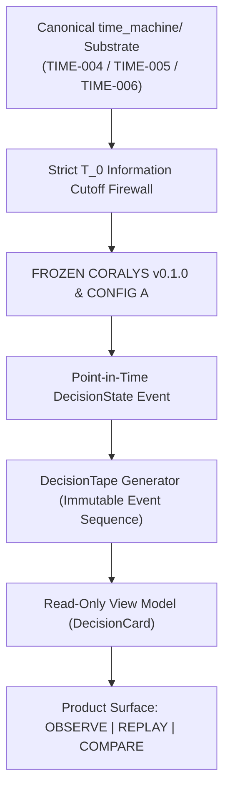

# RP-600 — Time Machine Decision Surface Specification

> [!IMPORTANT]
> **Governance & Four Architectural Locks**
> 1. **Research Layer**: Coralys `v0.1.0` and Config A ($K=3, G_{\text{max}}=0.70, \Delta M_{5,\text{min}}=-0.10$) are 100% **FROZEN**. Zero score formula changes, zero threshold hunting.
> 2. **Temporal Substrate**: Strictly reuses existing `time_machine/` pipeline (`TIME-004` Ledger, `TIME-005` Observations, `TIME-006` Evidence) with a strict $T_0$ firewall. Zero second Time Machine implementations.
> 3. **Decision Surface Contract**: `DecisionTape` and `DecisionCard` expose resolution-qualified trajectory evidence, `PARTIAL AGREEMENT`, and `TIME-SCALE CONFLICT` objects.
> 4. **Product Boundary**: Read-only translation layer. Zero frontend signal calculation, zero score reinterpretation, zero composite score creation, zero reconstructed decision semantics.

---

## 1. System Architecture & Product Boundary

```text
Canonical DecisionState
        │
        ├── direction
        ├── trajectory (resolution-qualified)
        ├── resolutions (15m, 30m, 1d)
        ├── cross-resolution relationship
        ├── risk state
        ├── decision state
        └── evidence
                │
                ▼
        Deterministic View Model (DecisionCard)
                │
                ├── timestamp (canonical temporal identity: Unix epoch int)
                ├── datetime (deterministic display projection: ISO-8601 UTC string)
                ├── display labels & formatting
                └── timeline positioning
                │
                ▼
             UI (OBSERVE | REPLAY | COMPARE)
```



---

## 2. Invariant Rules & UI Implementation Test

### Canonical Field Derivation Invariant
> **Every DecisionCard field must either come directly from canonical DecisionState/evidence or be an explicitly specified deterministic presentation projection. No field may introduce new semantic inference.**

### Strict UI Agent Implementation Test
> **If deleting a field from the canonical DecisionTape makes the UI unable to display it, that field must be traced upstream. The frontend must NEVER reconstruct it from other fields.**

*Example*: The UI display string `"REVERSAL DEVELOPING"` must be received directly from `card.risk_state`. The frontend must **not** execute conditional checks like:
```javascript
// FORBIDDEN IN FRONTEND
if (res15m === "REVERSAL" && res1d === "REVERSAL") {
    riskState = "REVERSAL DEVELOPING"; // DO NOT DO THIS
}
```

### Presentation Projection Rules
- `timestamp`: Canonical temporal identity (integer Unix epoch timestamp, e.g., `1782186300`).
- `datetime`: Deterministic presentation projection of `timestamp` formatted as an ISO-8601 UTC string (e.g., `"2026-06-23T03:45:00Z"`).

### Development Mode Provenance Audit Contract
In development/debug mode, every field's origin can be verified via the provenance schema:
```json
{
  "field": "decision_state",
  "value": "EXIT",
  "source": "canonical_decision_state"
}
```
and for presentation projections:
```json
{
  "field": "datetime",
  "value": "2026-06-23T03:45:00Z",
  "source": "presentation_projection",
  "derivation": "ISO-8601-UTC(timestamp)"
}
```

---

## 3. Product Surface Modes & Visualization Architecture

### A. OBSERVE (Live Surface)
Answers: *"What is happening now, and what evidence supports it?"*
- Displays live `DecisionCard` with current price, 15m/30m/1d horizon labels and scores, `cross_resolution_relationship`, `risk_state`, `decision_state`, and bulleted `evidence`.
- Completely read-only; no frontend scoring or signal derivation.

### B. REPLAY (Temporal Simulator)
Answers: *"What did the decision engine know at each historical instant?"*
- Chronological step-by-step traversal: $T_0 \to T_1 \to T_2 \to \dots \to T_n$.
- User navigation (`◀ Previous`, `Next ▶`, step index `5 / 8`).
- Experiential validation instrument demonstrating temporal decision evolution.

### C. COMPARE (Multi-Horizon Alignment Viewer)
Answers: *"How do trajectories align or conflict across time scales?"*
- Exposes resolution-qualified timeline rows across 15m, 30m, and 1d.
- Highlights structural transition events such as `TIME-SCALE CONFLICT` and `PARTIAL AGREEMENT`.
- Preserves multi-dimensional disagreement as explicit information without collapsing into a single magic composite score.

---

## 4. Formally Allowed vs. Forbidden Matrix

```text
FORBIDDEN IN RP-600 & UI IMPLEMENTATION:
❌ Creating a new Time Machine engine
❌ Modifying Coralys score formulas or threshold tuning
❌ Dashboard-side signal inference or composite "magic scores"
❌ Frontend reconstruction of risk states or decision states
❌ Inventing aggregate trajectory states (e.g. trajectory_state = NORMAL)

ALLOWED IN RP-600 & UI IMPLEMENTATION:
✓ Consuming canonical TIME-004 / 005 / 006 DecisionTape objects
✓ Rendering read-only DecisionCards with explicit canonical evidence
✓ Deterministic display formatting (e.g. timestamp -> ISO-8601 UTC datetime string)
✓ Stepping chronologically T_0 -> T_1 -> T_2 in REPLAY mode
✓ Rendering multi-horizon alignment matrices in COMPARE mode
```

---

## 5. Canonical Decision Card View Model Schema

```json
{
  "card_id": "card_RELIANCE.NS_1782186300",
  "instrument": "RELIANCE.NS",
  "timestamp": 1782186300,
  "datetime": "2026-06-23T03:45:00Z",
  "current_price": 1324.60,
  "resolutions": {
    "15m": {
      "label": "REVERSAL",
      "score": -0.6360
    },
    "30m": {
      "label": "INSUFFICIENT",
      "score": 0.5000
    },
    "1d": {
      "label": "REVERSAL",
      "score": -0.4561
    }
  },
  "cross_resolution_relationship": "PARTIAL AGREEMENT",
  "risk_state": "REVERSAL DEVELOPING",
  "decision_state": "EXIT",
  "evidence": [
    "• 15m trajectory crossed reversal boundary",
    "• 30m intermediate horizon observation insufficient",
    "• 1d macro horizon indicates structural reversal risk",
    "• 15m and 1d reversal confirmation, with 30m still insufficient"
  ]
}
```

---

## 6. Summary & UI Hand-off Directive

**Milestone RP-600** is architecturally complete and frozen.

**Directive for UI Agent**:
> **Implement the OBSERVE / REPLAY / COMPARE UI against the canonical DecisionTape/View Model. Do not modify `time_machine/`, Coralys v0.1.0, Config A, scoring, thresholds, or decision semantics. Any missing information required by the UI must be traced back to the canonical substrate rather than reconstructed in the frontend.**
