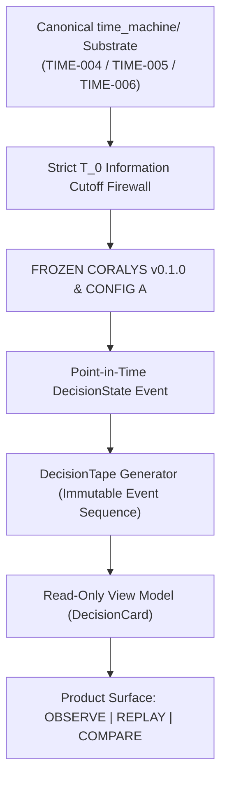

# RP-600 — Time Machine Decision Surface Specification

> [!IMPORTANT]
> **Governance & Architectural Invariants**
> - **Canonical Substrate**: Strictly reuses existing `time_machine/` pipeline (`TIME-004` Ledger, `TIME-005` Observations, `TIME-006` Evidence). Zero new decision engines created.
> - **Coralys Engine (`v0.1.0`)**: 100% **FROZEN** (Zero score formula changes).
> - **Position Trajectory Interpreter (`Config A`)**: 100% **FROZEN** ($K=3 \text{ bars}, G_{\text{max}}=0.70, \Delta M_{5,\text{min}}=-0.10$).
> - **Canonical Field Derivation Rule**: **Every DecisionCard field must either be copied directly from the canonical DecisionState/evidence or be a deterministic presentation projection whose derivation is explicitly specified. No field may introduce new semantic inference.**
> - **Read-Only Translation Layer**: The View Model is a pure translation layer. Zero score recalculations, zero threshold adjustments, zero dashboard-side inferences.

---

## 1. System Architecture & Product Boundary

```text
Canonical DecisionState
        │
        ├── direction
        ├── trajectory (resolution-qualified)
        ├── resolutions (15m, 30m, 1d)
        ├── cross-resolution relationship
        ├── risk state
        ├── decision state
        └── evidence
                │
                ▼
        Deterministic View Model (DecisionCard)
                │
                ├── display labels
                ├── formatting
                ├── grouping
                └── timeline positioning
                │
                ▼
             UI (OBSERVE | REPLAY | COMPARE)
```



---

## 2. Three Product Modes

| Mode | Temporal Cutoff | Operational Focus | Primary User Action |
|---|---|---|---|
| **`OBSERVE`** | `T = NOW` | Live current decision state & evidence cards | Monitor live positions & active evidence |
| **`REPLAY`** | `T = T_0` (Historical) | Prospective historical decision simulation | Advance step-by-step $T_0 \to T_1 \to T_2$ |
| **`COMPARE`** | Cross-Resolution | Timeline evolution viewer (15m vs 30m vs 1d) | Inspect multi-horizon alignment/conflicts |

---

## 3. Formally Allowed vs. Forbidden Matrix

```text
FORBIDDEN IN RP-600:
❌ Creating a new Time Machine engine
❌ Modifying Coralys score formulas
❌ Altering Config A parameters or threshold hunting
❌ Injecting future price / lookahead information
❌ Dashboard-side signal inference or composite "magic scores" (e.g. inventing trajectory_state = NORMAL when evidence shows REVERSAL)

ALLOWED IN RP-600:
✓ Reading existing TIME-004 / 005 / 006 observations and evidence
✓ Composing point-in-time states into reproducible DecisionTape objects
✓ Rendering DecisionCards with explicit canonical evidence justifications
✓ Exposing resolution-qualified trajectory states (15m, 30m, 1d) and PARTIAL AGREEMENT objects
✓ Stepping chronologically T_0 -> T_1 -> T_2
```

---

## 4. Canonical Decision Card View Model Schema

```json
{
  "card_id": "card_RELIANCE.NS_1782186300",
  "instrument": "RELIANCE.NS",
  "timestamp": 1782186300,
  "datetime": "1782186300",
  "current_price": 1324.60,
  "resolutions": {
    "15m": {
      "label": "REVERSAL",
      "score": -0.6360
    },
    "30m": {
      "label": "INSUFFICIENT",
      "score": 0.5000
    },
    "1d": {
      "label": "REVERSAL",
      "score": -0.4561
    }
  },
  "cross_resolution_relationship": "PARTIAL AGREEMENT",
  "risk_state": "REVERSAL DEVELOPING",
  "decision_state": "EXIT",
  "evidence": [
    "• 15m trajectory crossed reversal boundary",
    "• 30m intermediate horizon observation insufficient",
    "• 1d macro horizon indicates structural reversal risk",
    "• 15m and 1d reversal confirmation, with 30m still insufficient"
  ]
}
```

---

## 5. Summary & Hand-off Directive

**Milestone RP-600** establishes the read-only decision surface around the existing `time_machine/` substrate. Research semantics and computational formulas remain 100% frozen.

**Directive for UI Implementation**:
> **Implement the OBSERVE / REPLAY / COMPARE UI against the canonical DecisionTape/View Model. Do not modify `time_machine/`, Coralys v0.1.0, Config A, scoring, thresholds, or decision semantics. Any missing information required by the UI must be traced back to the canonical substrate rather than reconstructed in the frontend.**
