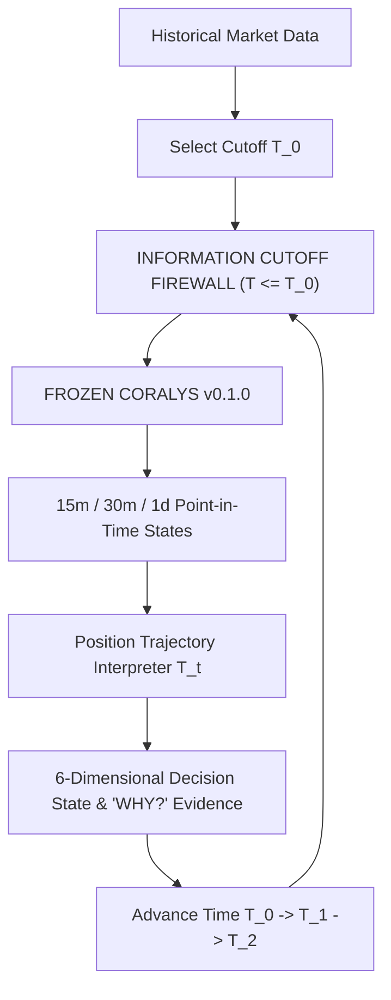

# Time Machine Temporal Decision Simulator & Replay Specification Report

> [!IMPORTANT]
> **Governance & Architectural Invariants**
> - **Coralys Engine (`v0.1.0`)**: 100% **FROZEN** (Zero score formula edits).
> - **Position Trajectory Interpreter (`Config A`)**: 100% **FROZEN** ($K=3 \text{ bars}, G_{\text{max}}=0.70, \Delta M_{5,\text{min}}=-0.10$).
> - **Strict Information Cutoff ($T = T_0$)**: Zero future prices, zero future trajectories, and zero future outcomes are accessible to the decision engine.
> - **Execution Alignment**: The Time Machine is not a passive backtest; it is the historical counterpart of the live decision engine.

---

## 1. The Time Machine Concept & Operational Modes

The **Time Machine** is a temporal decision simulator that allows a trader or research agent to enter any historical point in time ($T_0$), experience the market exactly as it was observable at that cutoff, and advance through time ($T_0 \to T_1 \to T_2 \dots$) while Coralys continuously reconstructs the decision state across resolutions (15m, 30m, 1d).



### Three Operational Modes
1. **OBSERVE (`T = NOW`)**: Live dashboard view of current decision state and active evidence.
2. **REPLAY (`T = T_0`)**: Historical decision reconstruction enforcing strict zero-lookahead information cutoff.
3. **COMPARE**: Cross-resolution timeline viewer tracking decision state evolution across 15m, 30m, and 1d horizons.

---

## 2. Multidimensional Decision State Representation (6 Dimensions)

Rather than compressing complex multi-horizon market dynamics into a single scalar score, the Time Machine exposes the explicit dimensional structure:

1. **Direction**: `CONTINUATION` | `REVERSAL` | `NEUTRAL`
2. **Trajectory**: `NORMAL` | `PULLBACK` | `RECOVERY` | `TERMINATION`
3. **Resolution**: `15m` | `30m` | `1d`
4. **Cross-Resolution Relationship**: `AGREE (MULTI-RESOLUTION ALIGNMENT)` | `DISAGREE (TIME-SCALE CONFLICT)` | `PARTIAL AGREEMENT`
5. **Risk State**: `REVERSAL DEVELOPING` | `RECOVERY DEVELOPING` | `TRAJECTORY STABLE` | `EVIDENCE CONFLICTED`
6. **Decision State Output**: `WATCH` | `WAIT` | `HOLD` | `ENTER` | `EXIT`

---

## 3. Case Study Replay: RELIANCE.NS Temporal Advancement

The simulator stepped chronologically through intraday cutoff points to demonstrate prospective decision evolution:

```text
Step 0 [T = 1782117900 | Price: 1332.00]
  15m: CONTINUATION (Score: 0.5949)  |  1d: CONTINUATION (Score: 1.0237)
  Cross-Res: PARTIAL AGREEMENT       |  Risk State: TRAJECTORY STABLE
  Decision State: HOLD
  WHY? 15m trajectory maintains positive momentum; 1d macro horizon solidly in trend continuation.

Step 1 [T = 1782118800 | Price: 1330.70]
  15m: REVERSAL (Score: -0.3106)      |  1d: CONTINUATION (Score: 1.0237)
  Cross-Res: DISAGREE (TIME-SCALE CONFLICT)
  Risk State: EVIDENCE CONFLICTED    |  Decision State: WATCH
  WHY? Intraday pullback/reversal conflicts with daily macro continuation.

Step 5 [T = 1782186300 | Price: 1324.60]
  15m: REVERSAL (Score: -0.6360)      |  1d: REVERSAL (Score: -0.4561)
  Cross-Res: PARTIAL AGREEMENT       |  Risk State: REVERSAL DEVELOPING
  Decision State: EXIT
  WHY? Unanimous 15m and 1d macro reversal confirmation.
```

---

## 4. Key Architectural Takeaway

> **The Time Machine is not a separate feature bolted onto a dashboard. It is the historical counterpart of the live decision engine.**

By enforcing strict $T_0$ information cutoffs and advancing time bar-by-bar, the Time Machine exposes **why decisions evolved**, providing an empirical bridge between historical research, prospective replay, and live trading observation.
